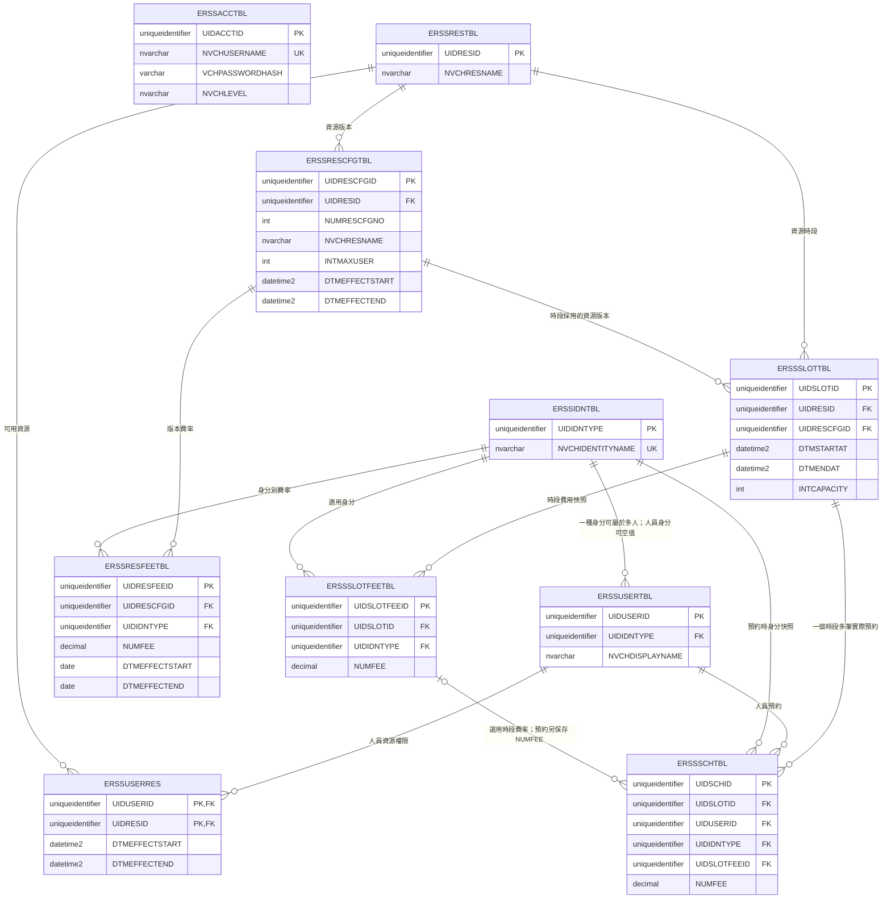

# ERSS 資料表與關聯

此圖依 `InitializeErss.sql` 與 `UpgradeSchedulingSchema.sql` 執行後的 ERSS schema 整理。

## 關聯摘要

- `ERSSACCTBL` 是登入帳戶；它刻意不連到 `ERSSUSERTBL`。人員名單不需要帳密。
- `ERSSUSERTBL.UIDIDNTYPE` 可為 `NULL`；有身分別時參照 `ERSSIDNTBL`。
- `ERSSRESTBL` 是穩定資源主檔；`ERSSRESCFGTBL` 保存每次設定版本與生效區間。
- `ERSSRESFEETBL` 將費率綁定資源版本及身分別，生效起訖為必填 `DATE` 且含首尾日；資源 ID 由版本表推得，避免重複欄位不一致。
- `ERSSUSERRES` 是人員與資源的多對多使用權限，複合主鍵為 `(UIDUSERID, UIDRESID)`。
- `ERSSSLOTTBL` 是可排時段，不是實際預約；容量可低於設定版本的資源人數上限。
- `ERSSSLOTFEETBL` 在時段建立時保存各身分別的費率快照。
- `ERSSSCHTBL` 是實際預約，一人一筆；每筆保留預約身分及 `NUMFEE` 金額快照。

## 舊表遷移

- 舊 `ERSSSCHTBL`（可排時段）更名為 `ERSSSLOTTBL`。
- 舊 `ERSSSCHUSERTBL`（時段人員明細）更名為 `ERSSSCHTBL`。
- 既有資源初始化為設定版本 1；既有費率指向版本 1；既有時段亦指向版本 1。
- 既有預約保留 `NUMFEE`，不會自動填 `UIDSLOTFEEID`，避免把歷史預約錯配到新的費率快照。
- 舊費率的空白結束日會遷移為明確日期 `9999-12-31`；若舊費率在轉成日期精度後期間重疊，遷移會中止並回滾，需先整理衝突資料。
