# ERSS 資料表與關聯

此圖依 ErssSchema.sql 建立的 ERSS 資料表整理。

```mermaid
erDiagram
    ERSSACCTBL {
        uniqueidentifier UIDACCTID PK
        nvarchar NVCHUSERNAME UK
        varchar VCHPASSWORDHASH
        nvarchar NVCHLEVEL
    }
    ERSSUSERTBL {
        uniqueidentifier UIDUSERID PK
        uniqueidentifier UIDIDNTYPE FK
        nvarchar NVCHDISPLAYNAME
    }
    ERSSIDNTBL {
        uniqueidentifier UIDIDNTYPE PK
        nvarchar NVCHIDENTITYNAME UK
    }
    ERSSRESTBL {
        uniqueidentifier UIDRESID PK
        nvarchar NVCHRESNAME
    }
    ERSSRESCFGTBL {
        uniqueidentifier UIDRESCFGID PK
        uniqueidentifier UIDRESID FK
        int NUMRESCFGNO
        nvarchar NVCHRESNAME
        int INTMAXUSER
        date DTMEFFECTSTART
        date DTMEFFECTEND
    }
    ERSSRESFEETBL {
        uniqueidentifier UIDRESFEEID PK
        uniqueidentifier UIDRESCFGID FK
        uniqueidentifier UIDIDNTYPE FK
        decimal NUMFEE
    }
    ERSSUSERRESTBL {
        uniqueidentifier UIDUSERID PK, FK
        uniqueidentifier UIDRESID PK, FK
        date DTMEFFECTSTART
        date DTMEFFECTEND
    }
    ERSSSLOTTBL {
        uniqueidentifier UIDSLOTID PK
        uniqueidentifier UIDRESID FK
        uniqueidentifier UIDRESCFGID FK
        datetime2 DTMSTARTAT
        datetime2 DTMENDAT
        int INTCAPACITY
    }
    ERSSSCHTBL {
        uniqueidentifier UIDSCHID PK
        uniqueidentifier UIDSLOTID FK
        uniqueidentifier UIDUSERID FK
        uniqueidentifier UIDIDNTYPE FK
        decimal NUMFEE
    }

    ERSSIDNTBL ||--o{ ERSSUSERTBL : "一種身分可屬於多人；人員身分可空值"
    ERSSRESTBL ||--o{ ERSSRESCFGTBL : "資源版本"
    ERSSRESCFGTBL ||--o{ ERSSRESFEETBL : "版本費率"
    ERSSIDNTBL ||--o{ ERSSRESFEETBL : "身分別費率"
    ERSSUSERTBL ||--o{ ERSSUSERRESTBL : "人員資源權限"
    ERSSRESTBL ||--o{ ERSSUSERRESTBL : "可用資源"
    ERSSRESTBL ||--o{ ERSSSLOTTBL : "資源時段"
    ERSSRESCFGTBL ||--o{ ERSSSLOTTBL : "時段採用的資源版本"
    ERSSSLOTTBL ||--o{ ERSSSCHTBL : "一個時段多筆實際預約"
    ERSSUSERTBL ||--o{ ERSSSCHTBL : "人員預約"
    ERSSIDNTBL ||--o{ ERSSSCHTBL : "預約時身分快照"
```

## 關聯摘要

- `ERSSACCTBL` 是登入帳戶；它刻意不連到 `ERSSUSERTBL`。人員名單不需要帳密。
- `ERSSUSERTBL.UIDIDNTYPE` 可為 `NULL`；有身分別時參照 `ERSSIDNTBL`。
- `ERSSRESTBL` 是穩定資源主檔；`ERSSRESCFGTBL` 保存每次設定版本與生效區間。
- `ERSSRESCFGTBL` 保存設定版本的生效起訖（`DATE`），結束日必填；持續有效版本以 `9999-12-31` 表示；新增版本可與舊版期間重疊，費率按版本設定。`ERSSRESFEETBL` 每個版本每種身分別一筆，只保存版本、身分別及費用。
- `ERSSUSERRESTBL` 是人員與資源的多對多使用權限，複合主鍵為 `(UIDUSERID, UIDRESID)`。
- `ERSSSLOTTBL` 是可排時段，不是實際預約；容量可低於設定版本的資源人數上限。
- 預約依時段的設定版本與預約人的身分別查詢 `ERSSRESFEETBL`，並將當次金額寫入 `ERSSSCHTBL.NUMFEE`。
- `ERSSSCHTBL` 是實際預約，一人一筆；每筆保留預約身分及 `NUMFEE` 金額快照。

## 初始化

在 Azure SQL 或 SQL Server 建立空白的 ERSS 資料庫，直接連線到該資料庫後執行 `ErssSchema.sql`。腳本會建立資料表、索引及 `erss_app_role`。另行建立網站使用的資料庫使用者並加入該角色，網站登入帳號則存於 `ERSSACCTBL`。
